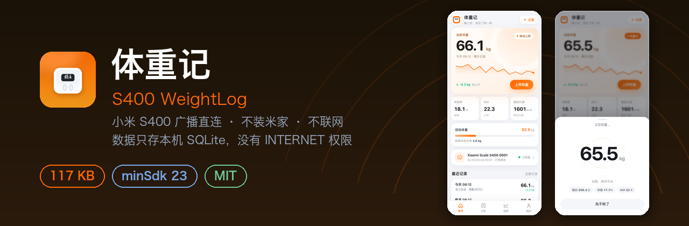
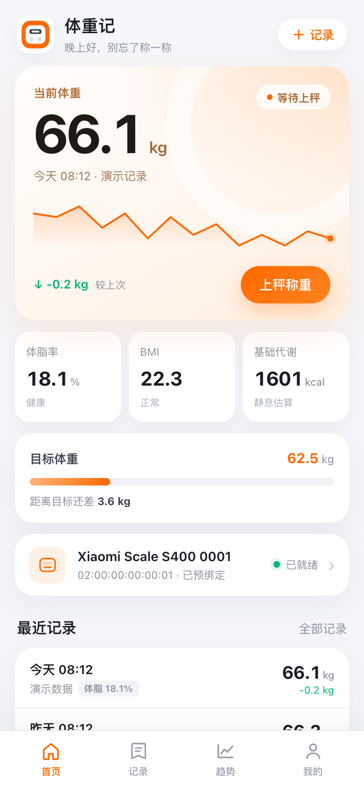
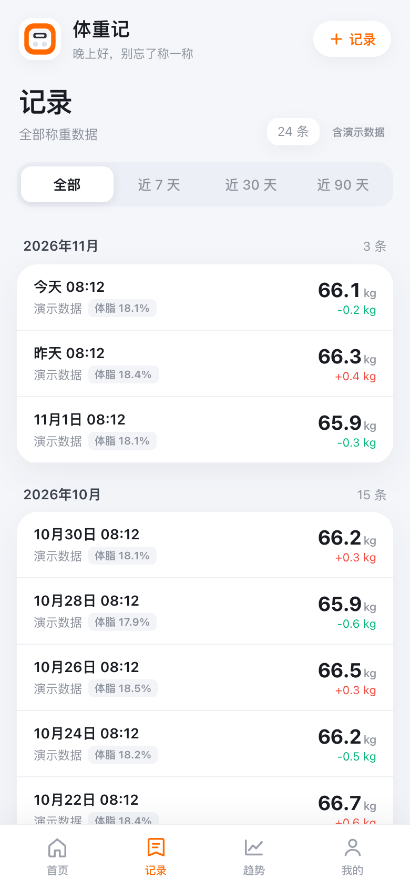
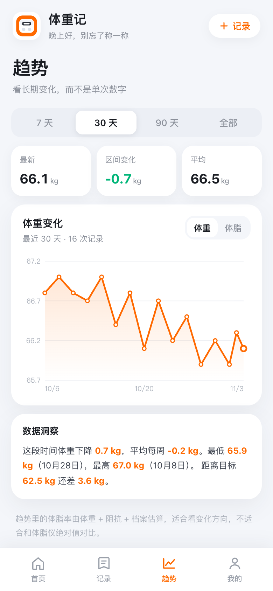
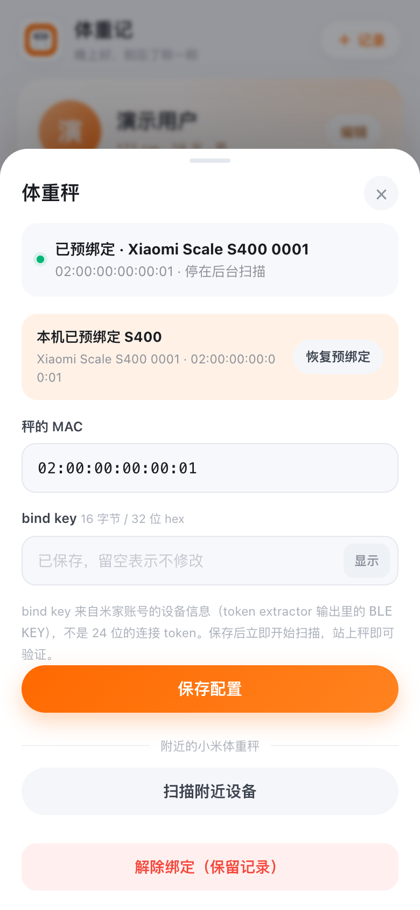
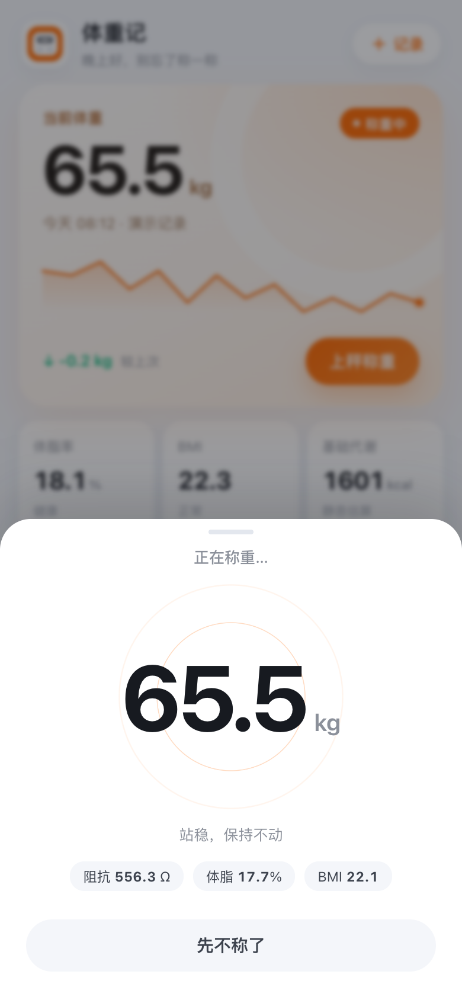
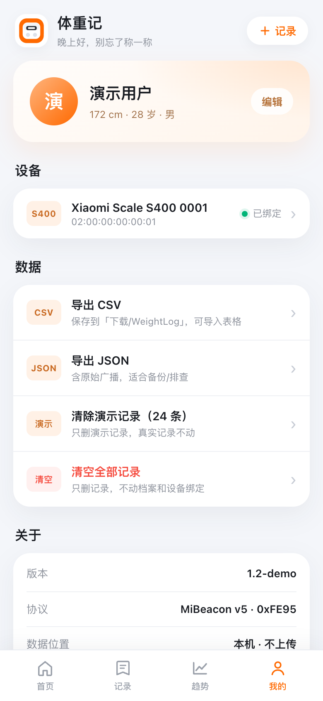
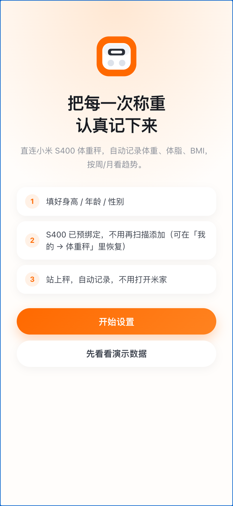

<p align="center">
  
</p>

<p align="center">
  <a href="../../releases/latest"></a>
</p>

<p align="center">
  
  
  
  
</p>

<p align="center">
  <b>体重秤的数据，留在你自己手机里。</b>直连小米 S400 的 BLE 广播，不装米家、不联网 —— 安装包里没有 <code>INTERNET</code> 权限，117 KB。
</p>

## 为什么用它

- **不联网，也没法联网** — `AndroidManifest.xml` 里没有 `INTERNET` 权限，体重记录只落本机 SQLite，卸载即清空。
- **站上秤就出数** — 广播一到就自动弹出称重层并显示体重，稳定后入库；同一次称重 5 秒内不会重复记录。
- **一次称重算完四项** — 体重、体脂率、BMI、基础代谢，用测量当时的档案在本机估算。
- **换秤、恢复备份也不会失联** — 配置的 MAC 过期时自动重新发现广播，**bind key 解密成功才认秤**，然后把新地址写回配置。
- **数据随时带走** — 一键导出 CSV（Excel 直接打开）或 JSON 完整备份，导出文件不含密钥。

## 截图

<p align="center">
  
  
  
  
  
</p>

<p align="center"><sub>截图使用 App 内置的演示数据（浏览器打开 <code>?reset=1</code>），不是真实称重记录。</sub></p>

<details>
<summary>更多截图</summary>

<p align="center">
  
  
</p>

</details>

## 安装

1. 到 **[Releases](../../releases/latest)** 下载 `weightlog-1.2.apk`。
2. 点开安装；系统提示「未知来源」时允许当前文件管理器安装。
3. 打开后填身高 / 年龄 / 性别，再到「我的 → 体重秤」填秤的 MAC 和 32 位 bind key。

```bash
# 也可以命令行安装
adb install -r weightlog-1.2.apk
```

不需要 Google 服务；首次绑定要联网取一次 key（用电脑上的 token extractor），填进 App 之后 App 自己不联网。
取 key 与失效后重新绑定的完整流程见 [docs/S400-BINDING.md](docs/S400-BINDING.md)。

## 功能

**称重**

- 站上秤自动弹出称重层，稳定后自动保存；熄屏 / 切后台也会补存
- 手动补录：可改体重、时间和备注
- 最近 30 天小折线直接显示在首页

**记录与趋势**

- 按月份分组，显示较上次变化、来源（秤 / 手动 / 演示）与体脂率
- 7 / 30 / 90 天 / 全部四档趋势，含目标线、最低 / 最高 / 周均变化
- 目标体重进度：增重目标和减重目标都能正确判断方向

**设备**

- 填 MAC + 32 位 bind key 绑定；构建时也可预绑定
- 「扫描附近设备」自动填 MAC（只能拿到 MAC 和广播名，拿不到 key）
- 地址兜底：超时或连续解密失败后重新发现，解密成功才自动纠正 MAC

**数据**

- 导出 CSV / JSON 到 `下载/WeightLog/`；CSV 带 UTF-8 BOM，中文不乱码
- 表格公式注入防护：以 `=` `+` `-` `@` 开头的单元格加 `'` 前缀
- 演示数据可单独清除，不影响真实记录

<details>
<summary>导出字段</summary>

CSV 表头：

```text
measured_at,weight_kg,impedance_low_ohm,impedance_high_ohm,heart_rate,body_fat_pct_est,bmi,bmr_kcal_est,source,note
```

JSON 是完整备份：每条记录除数值外还带测量当时的档案快照（`profile_height_cm` / `profile_age` / `profile_sex`）、`created_at_ms` 和原始广播 `raw_json`（没有原始广播时为 `null`）。

</details>

## 使用提示

- **bind key 是 32 位，不是 24 位** — 要填 token extractor 输出里的 `BLE KEY`；24 位的 `TOKEN` 是 GATT 登录用的，填错只会报「解密失败」。
- **称重时 App 要在前台** — 手机蓝牙打开、和秤在同一房间（BLE 一般 5–10 米，隔墙会弱）。
- **秤重置后要重新取 key** — 米家解绑 / 重新绑定 / 换账号都会轮换 bind key。
- **换机前先导出** — 数据只存在旧机私有目录，卸载即丢。

## 兼容性

| 项目 | 说明 |
|---|---|
| 最低版本 | Android 6.0（API 23） |
| 目标版本 | Android 12（API 31） |
| 设备 | 小米 S400（`MJTZC01YM` / `yunmai.scales.ms104`），MiBeacon v5（`0xFE95`） |
| 依赖 | 无 native 库、无 AndroidX、无第三方运行时依赖 |
| 权限 | 蓝牙扫描 / 连接；Android 11 及以下定位；Android 9 及以下存储写。**没有 `INTERNET`** |

## 已知限制

- **只监听广播，不建立 GATT 连接** — 所以没有逐帧实时流，只有称重末尾的 2 个包；GATT 实时通道需要 12 字节登录 token，协议见 [docs/S400-PROTOCOL.md](docs/S400-PROTOCOL.md)。
- **只解析 S400 的 `0x6E16` / `0x4E16` 对象** — 老款明文广播秤（`0x181B` / `0x181D`）不解。
- **体脂 / BMR 是估算** — 社区公式，不是米家官方结果；看趋势比看绝对值可靠。
- **不能导入** — CSV / JSON 只能导出，换机后无法导回（1.3 规划）。
- **bind key 是明文静态存储** — 无 Keystore / `EncryptedSharedPreferences`；`allowBackup=false` 挡得住 `adb backup`，挡不住 root。已绑定 MAC 下未加密帧也会被当成本秤数据；BLE 帧无防重放；「显示」key 时没有 `FLAG_SECURE`。
- **未在 Android 6–8 真机实测** — 只在 API 30 模拟器上跑过完整流程，见「已验证」。

## 构建

<details>
<summary>构建方法</summary>

需要 JDK 17 + Android SDK（build-tools 37、platform 31 以上），不依赖 Gradle：

```bash
bash build.sh                 # → apks/weightlog-<version>.apk
bash build.sh --install       # 构建并安装到已连接手机
bash build.sh --no-preset     # 不预绑定，出干净包
```

`build.sh` 默认从**仓库外**的 env 文件（默认 `../scale/.env`）读 `S400_MAC` / `S400_BLE_KEY`，注入 `BuildConfig` 做首启预绑定；文件不存在时自动退化为不预绑定。
签名用本地 debug 证书（`debug.keystore`，已 gitignore，缺失时自动生成，不入库）。

</details>

<details>
<summary>项目结构</summary>

```text
src/com/weightlog/app/
├── MainActivity.java      生命周期、WebView、权限、扫描、落库、导出
├── bridge/Bridge.java     @JavascriptInterface + 原生 → JS 事件
├── scale/                 MiBeacon 解析、AES-CCM、扫描、称重状态机、地址兜底、体成分公式
├── data/                  SharedPreferences 配置、记录模型、SQLite
└── export/                CSV / JSON 导出（MediaStore 与旧系统两条路径）
assets/www/                UI：index.html / style.css / app.js / bridge-demo.js
test/                      纯 JVM 回归（135 条断言，不需要 Android SDK）
docs/                      绑定、协议、隐私文档与截图
```

开发约定、桥接口契约与发版流程见 [AGENTS.md](AGENTS.md)。

</details>

## 已验证

- **API 30 模拟器（arm64）**：安装启动、首启预绑定、权限被拒时的提示与「去设置」、授权后自动继续扫描、24 条演示数据、手动补录、导出 CSV / JSON、无 `FATAL`。
- **纯 JVM 回归 135 条**：S400 帧结构与解析、NIST SP 800-38C AES-CCM 向量、称重状态机、体成分边界、地址兜底策略。
- **未验证**：Android 6–8 真机；家人多档案（2.0 规划）；老款明文广播秤。

## 数据来源与致谢

- 广播与 GATT 协议整理自 [Bluetooth-Devices/xiaomi-ble](https://github.com/Bluetooth-Devices/xiaomi-ble)、[ESPHome xiaomi_body_scale](https://esphome.io/components/sensor/xiaomi_body_scale/)、[MIoT S400 spec](https://home.miot-spec.com/spec?type=urn:miot-spec-v2:device:scale:0000A07D:yunmai-ms104:1)
- GATT 登录握手参考 [nokistin/xiaomi-s400-live](https://github.com/nokistin/xiaomi-s400-live) 与 [kbpk/xiaomi-s400-homeassistant](https://github.com/kbpk/xiaomi-s400-homeassistant)
- 兼容性问题参考 [openScale #1188](https://github.com/oliexdev/openScale/issues/1188)、[Gadgetbridge #4501](https://codeberg.org/Freeyourgadget/Gadgetbridge/issues/4501)

> 本项目与小米 / 米家无关联，协议信息为第三方逆向整理结果；固件更新后可能失效（实测固件 `2.1.1_0006`）。

## 更多

- 绑定与密钥：[docs/S400-BINDING.md](docs/S400-BINDING.md)
- 协议与 GATT 登录：[docs/S400-PROTOCOL.md](docs/S400-PROTOCOL.md)
- 隐私与威胁模型：[docs/S400-PRIVACY.md](docs/S400-PRIVACY.md)
- 变更记录：[CHANGELOG.md](CHANGELOG.md)
- 问题与建议：[Issues](../../issues)

## License

[MIT](LICENSE)。
